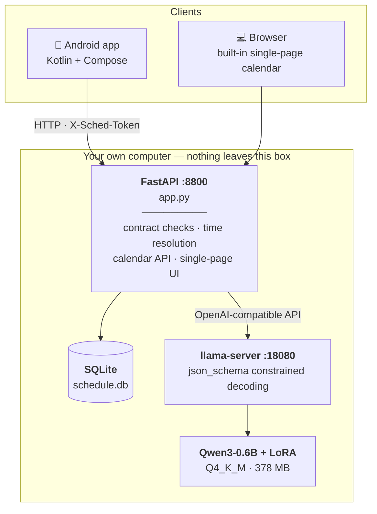
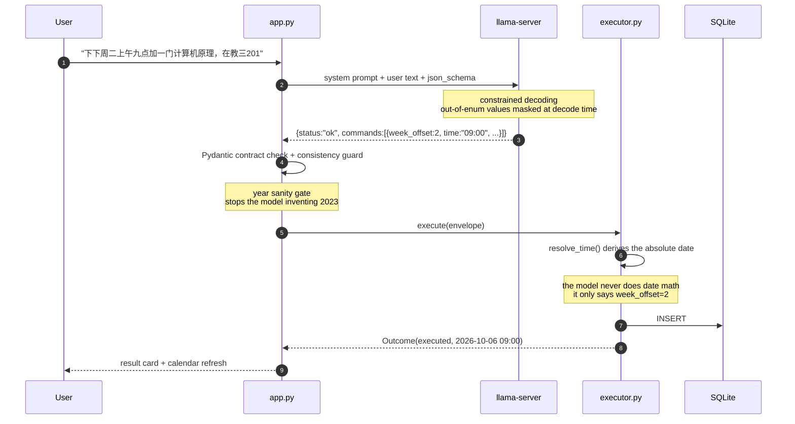
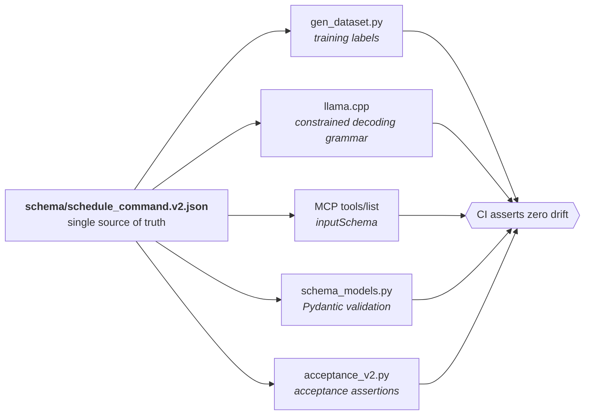
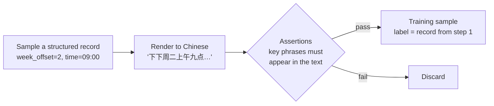

# Local Schedule Assistant

**One Chinese sentence in, a structured tool call out, a real calendar on screen. All of it runs on your own machine.**

[中文](README.md) · [Architecture](#architecture) · [Quick start](#quick-start) · [Design tradeoffs](#design-tradeoffs-every-one-of-them-earned-the-hard-way)

```text
"下下周二上午九点加一门计算机原理，在教三201"
 ("add a Computer Architecture class next-next Tuesday at 9am, room 教三201")
        │
        │  Qwen3-0.6B + LoRA  ── constrained decoding via llama.cpp
        ▼
{"module":"class","action":"add","title":"计算机原理",
 "when":{"date_kind":"weekday","date_value":"TU","week_offset":2,
         "time":"09:00","period":"am"},"location":"教三201"}
        │
        │  Pydantic contract check → deterministic resolve_time()
        ▼
2026-10-06 09:00  Computer Architecture (教三201)
```

The model is **0.6B parameters** (378 MB after Q4 quantization) and answers in a median of
**850 ms** on a thin-and-light laptop's integrated GPU. No API calls. Nothing leaves the machine.

---

## Contents

- [What problem this solves](#what-problem-this-solves)
- [Architecture](#architecture)
- [One schema, five consumers](#one-schema-five-consumers)
- [Quick start](#quick-start)
- [Performance and correctness](#performance-and-correctness)
- [How the training data is made](#how-the-training-data-is-made)
- [Design tradeoffs (every one of them earned the hard way)](#design-tradeoffs-every-one-of-them-earned-the-hard-way)
- [Project layout](#project-layout)
- [Known limitations](#known-limitations)
- [License](#license)

---

## What problem this solves

Making a small model **drive real tools reliably** instead of just sounding plausible.

The usual way to give an LLM a tool is: write a function signature, paste the JSON Schema into
the prompt, hope for valid JSON, then patch things up with regex or a retry loop. With a 0.6B
model that approach mostly fails — it invents enum values that don't exist, gets dates wrong,
and puts times in the wrong field.

This project takes a different angle: make reliability a **structural guarantee** rather than a
post-hoc cleanup.

| | The usual approach | What this does |
|---|---|---|
| Valid output | "Only output JSON" in the prompt, then validate and retry on failure | **Constrained decoding** — out-of-enum values are masked at the logit level, so they are structurally impossible |
| Date arithmetic | Let the model work out which day "next-next Tuesday" is | The model only emits `week_offset: 2`; **absolute dates come from deterministic code** that can be unit-tested |
| Contract consistency | One schema, one set of training labels, one validator — all drifting apart | **One JSON Schema derives all of them**, with a CI assertion for zero drift |
| Training data | Hand-written or scraped, labels correct by luck | **Reverse construction** — sample the structured record first, render it to Chinese, labels correct by construction |

In one line: **push uncertainty to where it belongs.** The model's job is "understand what the
sentence means", not "do calendar math" or "guarantee the format".

---

## Architecture



**The phone only handles input and display.** All parsing, inference and storage happen on the
computer. That means no model on the phone, no data migration when you switch phones, and exactly
one place to upgrade the model.

### The full path of one request



---

## One schema, five consumers

This is the central engineering decision. `schema/schedule_command.v2.json` is the **single
source of truth**:



Why it matters: if the training labels and the production validator are built from different
contracts, what the model learned and what you actually want drift apart — and they drift
**silently**. Training loss keeps dropping. You find out in production.

With a single source of truth, changing the contract becomes one atomic operation: edit the JSON,
run the generator, run CI. `python bridge/schema_models.py schema/schedule_command.v2.json`
field-by-field compares the Pydantic mirror against the JSON Schema and fails on any mismatch.

### What the contract looks like

```jsonc
{
  "status": "ok",                    // ok | clarify | reject
  "commands": [{
    "module": "class",               // class|exam|meeting|assignment|alarm|reminder|memo
    "action": "add",
    "title": "计算机原理",
    "when": {
      "date_kind": "weekday",        // absolute|offset_day|weekday|month_day|unspecified
      "date_value": "TU",
      "week_offset": 2,              // -2..4  ← see "the contract must express what users say"
      "time": "09:00",
      "period": "am"                 // am|pm|none
    },
    "location": "教三201"
  }]
}
```

---

## Quick start

### Prerequisites

- Python 3.10+
- Any machine that can run [llama.cpp](https://github.com/ggml-org/llama.cpp)
  (CPU alone is fine; a discrete or integrated GPU is much faster — see
  [Performance](#performance-and-correctness))
- About 400 MB of disk

### 1. Get the inference backend

Download the build for your platform from
[llama.cpp releases](https://github.com/ggml-org/llama.cpp/releases). You only need the
`llama-server` binary.

```bash
llama-server --version    # sanity check
```

### 2. Get the model

Download `qwen3-0.6b-sched-v4-Q4_K_M.gguf` (378 MB) from this repo's
[Releases](../../releases).

> `Q8_0` (610 MB) is available if you want a bit more quality, at roughly 20% slower.
> You can also train your own — see
> [How the training data is made](#how-the-training-data-is-made).

### 3. Start the inference server

```bash
llama-server \
  -m qwen3-0.6b-sched-v4-Q4_K_M.gguf \
  -ngl 99 \
  -c 2048 \
  --host 127.0.0.1 --port 18080 \
  --jinja \
  -np 1
```

- `-ngl 99` offloads all layers to the GPU/integrated GPU; use `-ngl 0` for pure CPU
- `--jinja` is **required** — the server must apply the chat template correctly, or the output
  will be wrong

Confirm `curl http://127.0.0.1:18080/health` returns ok.

### 4. Start the app

```bash
pip install -r bridge/requirements.txt

export SCHED_LLAMA_URL=http://127.0.0.1:18080
uvicorn app:app --app-dir bridge --host 127.0.0.1 --port 8800
```

Open <http://127.0.0.1:8800>.

> On Windows PowerShell, environment variables are `$env:SCHED_LLAMA_URL = "..."` and line
> continuation uses a backtick.
>
> There is also a Windows auto-start setup in this repo (scheduled task plus a crash-recovering
> supervisor loop) — see `local/supervise.ps1` and `docs/PROJECT-STATE.md` §7.

### 5. Reach it from your phone (optional)

**Do not expose port 8800 to the public internet** — this app has no authentication by default.
Use a private network like [Tailscale](https://tailscale.com/), or set an access token:

```bash
export SCHED_TOKEN=$(python -c "import secrets;print(secrets.token_urlsafe(24))")
uvicorn app:app --app-dir bridge --host 0.0.0.0 --port 8800
```

With a token set, every `/api/*` request must carry an `X-Sched-Token` header. The web UI prompts
for it on a 401; the Android app has a field for it in Settings. With no token set, behaviour is
identical to before — zero friction for local development.

Android client: **[AI-ScheduleAssistant](https://github.com/liuxinyang/AI-ScheduleAssistant)**.

---

## Performance and correctness

### Inference speed

Same model, same question, only the inference backend changed:

| Backend | Throughput | Median end-to-end latency |
|---|---|---|
| HuggingFace `generate()` | 11.5 tok/s | ~3800 ms |
| **llama.cpp (RTX 2080 Ti)** | **272 tok/s** | **262 ms** |
| **llama.cpp (Radeon 880M iGPU)** | 71 tok/s | 850 ms |
| llama.cpp (same iGPU, Q8_0) | 49 tok/s | 1044 ms |

A **24× gap** with almost no change to application code. The takeaway is blunt: for local
deployment of a small model, **the inference backend matters far more than model tuning**.
`generate()` synchronizes with the CPU on every token, and that is the whole story.

> The iGPU rows are an AMD Ryzen AI 9 365 with a Radeon 880M (Vulkan). Q4_K_M is about 1.5×
> faster than Q8_0. DirectML and the XDNA2 NPU were both tried and both lost to the Vulkan path;
> the process is written up in `docs/training-hardware-reality.md`.

### Correctness

| Check | Result |
|---|---|
| End-to-end cases (dates / week offsets / month offsets / refusals) | **21/21** |
| Date-parsing unit tests | 13/13 |
| Week / month offsets | 18/18 |
| Access control | 12/12 |
| Theme consistency across both clients | 10/10 |
| Dataset outputs conform to the schema (4372 samples) | **4372/4372** |
| Every dataset sample actually executed; failures counted | **failed = 0** |
| Contract drift | 0 |

The last two deserve a note. Every sample's `assistant` output is fed to the executor for real.
**"The label conforms to the schema" is not enough** — if the executor crashes on it, that sample
is untrainable no matter how well-formed it looks. The check lives in
`bridge/verify_dataset_e2e.py`.

CI runs exactly these commands; see `.github/workflows/ci.yml`.

---

## How the training data is made

**Reverse construction**: instead of annotating real text, do it backwards — sample a structured
record first, then render it into Chinese. The label is correct by construction.



**Step three is the whole point.** The generator remembers exactly what it said in that sentence
(whether it said "next-next week" or "next week"; whether it said "9:00" or "9am"), then asserts
those phrases really appear in the final text. If not, the sample is thrown away. Labels and text
cannot disagree.

> **Why bother?** The first version got this wrong: slot sampling and text rendering were two
> independent paths, which produced labels like `title:"午睡"` (nap) on the sentence "set an alarm
> for 7:30". The samples looked fine and training loss dropped normally, but the model was
> learning the wrong thing.
> **Reverse construction makes that class of bug impossible, rather than merely rare.**

### Training configuration

| | |
|---|---|
| Base model | Qwen3-0.6B (Apache-2.0) |
| Method | LoRA, r=16, alpha=32 |
| Data | 4000 train / 371 test (generated, not hand-labelled) |
| Steps | 750 |
| Wall clock | **16 minutes** (single GPU) |
| Final loss | 0.0003 (validation 0.0023) |
| Precision | fp16 + GradScaler |

Sixteen minutes per usable adapter is the real payoff of the 0.6B size:
**iteration is fast enough that data quality becomes the main variable you tune.**

To reproduce:

```bash
pip install -r pod/requirements-train.txt
python pod/gen_dataset.py --train 4000 --test 400 --outdir ./data
python pod/train_lora.py --data ./data --out ./output
```

> If you are short on VRAM, use `--batch 4 --accum 4`. Batch 8 OOMs — the logits tensor is
> `batch × seq × vocab`, i.e. 8×270×151936×4 B ≈ 1.3 GB.

---

## Design tradeoffs (every one of them earned the hard way)

### 1. The model does not do date arithmetic

Absolute time comes from `resolve_time()`. The model only emits *what it is relative to* and
*how far*.

Measured: the model turned **"今年12月31号" (Dec 31 this year) into 2023**. There is now a year
sanity gate — if the resolved absolute year is earlier than `current year - 1`, the request is
sent back as a clarification instead of being written.

### 2. The contract must be able to express what users say

v1 modelled week offsets as an enum, `week_ref: this | next`. The problem: **Chinese has
"下下周" (the week after next)** and the enum had no slot for it — so the model collapsed it to
`next` and **silently wrote the wrong week**.

`下下周二` became `下周二`: seven days off, and completely invisible in the UI.

The fix was not to add `next_next` (what about "the week after the week after next?"), but to
switch to a numeric `week_offset: -2..4`.

**A contract's expressive range is the ceiling on the model's capability** — anything the
contract cannot express, the model can only guess at.

### 3. Constrained decoding beats post-hoc validation

llama.cpp supports `response_format: {"type":"json_schema", ...}`, which masks the logits of
illegal tokens during decoding:

- Out-of-enum values become **structurally impossible** (unconstrained, values like
  `fuzzy:"before"` leak through)
- It costs essentially nothing in speed (272 vs 281 tok/s)

### 4. The system prompt is part of the model contract

It must be **byte-identical** to training time.

Measured: swapping the system prompt dropped the pass rate on real cases from **85% to 0%**.
The model learned "given *this* prompt, emit *this* format" — changing the prompt changes the task.

So `SYS` in `pod/gen_dataset.py` and `SYS` in `bridge/app.py` must always change together.

### 5. Colloquial contractions have to be in the training data

The four contractions 明早 / 今早 / 明晚 / 今晚 ("tomorrow morning" / "this morning" / "tomorrow
evening" / "tonight") were absent from the data, and the model dropped the date entirely —
"加个明早八点的闹钟" landed on **today**.

Added to the generator, retrained as v4, 8/8 passing. **The coverage of your synthetic data is
the capability boundary of your model.**

### 6. Keep structural validation loose and semantic policy strict

When the model emits `week_offset=5`, the right response is not a schema validation failure — it
is to let it pass structural validation and have the execution layer ask a human-readable
clarifying question.

So the Pydantic mirror bounds `week_offset` at `-99..99` (loose), and the `-2..4` policy limit is
applied only in the executor. **The validator answers "is this legal JSON"; the executor answers
"is this a reasonable thing to have said".**

---

## Project layout

```
├─ schema/
│  ├─ schedule_command.v2.json      ★ single source of truth
│  └─ schedule_command.v1.json        historical (week_ref enum, expressively limited)
│
├─ bridge/                            application layer
│  ├─ app.py                          FastAPI + single-page calendar + optional token auth
│  ├─ executor.py                     time resolution · execution · SQLite
│  ├─ schema_models.py                Pydantic contract mirror + drift check
│  ├─ static/theme.css                ★ generated by theme/, do not edit
│  └─ test_*.py / acceptance_v2.py    regression and acceptance suites
│
├─ theme/
│  ├─ tokens.json                     ★ single source of truth for colour (Paper / Night Ops)
│  └─ gen_theme.py                    emits web CSS + Android Kotlin
│
├─ pod/                               data generation and training
│  ├─ gen_dataset.py                  reverse-construction generator
│  ├─ train_lora.py                   LoRA training
│  └─ systemd/                        long-running services for a server
│
├─ local/                             Windows local deployment
│  ├─ supervise.ps1                   supervisor loop (crash recovery)
│  └─ install_autostart.ps1           auto-start via scheduled task
│
├─ docs/                              design notes and measured results
├─ scripts/audit_secrets.ps1          pre-open-source secret audit
└─ .github/workflows/ci.yml           BOM / secret audit / theme drift / tests / dataset
```

A few docs worth reading:

| Doc | Contents |
|---|---|
| `docs/mcp-how-it-actually-works.md` | The five layers of modern MCP tool calling, and how it differs from "regex the JSON" |
| `docs/training-hardware-reality.md` | Measured GPU / NPU / iGPU training results, including the dead ends |
| `docs/theming.md` | The token pipeline behind the two themes |
| `docs/PROJECT-STATE.md` | Project state snapshot and the full set of design decisions |

*(These are written in Chinese.)*

---

## Known limitations

- **`action` only supports `add`.** Editing and deleting are UI-only; there is no natural-language
  update / delete yet.
- **No reminder notifications.** Events live on the computer; the phone will not buzz.
- **Few negative samples.** Only 14 reject and 10 clarify examples, so refusal is the weak spot.
- **The web UI uses `color-mix()`**, which needs Chrome/Edge 111+ (March 2023). On older browsers
  some colours degrade to transparent, though nothing breaks.
- **The Paper theme's serif headings** rely on system fonts; Chinese serif implementations vary
  noticeably between Android vendors.
- **Single-user by design.** One backend serves one person. Sharing needs data isolation you add
  yourself — `Store` is a standalone class and a scope column would do it, see
  `docs/PROJECT-STATE.md` §9.

---

## License

[MIT](LICENSE)

Dependencies and credits:

| Component | License |
|---|---|
| [Qwen3-0.6B](https://huggingface.co/Qwen/Qwen3-0.6B) | Apache-2.0 |
| [llama.cpp](https://github.com/ggml-org/llama.cpp) | MIT |
| Training data | **synthesized by this repo's own scripts**, no third-party dataset |
| Android: OkHttp / Jetpack Compose | Apache-2.0 |

The fine-tuned LoRA weights inherit the base model's license (Apache-2.0).
