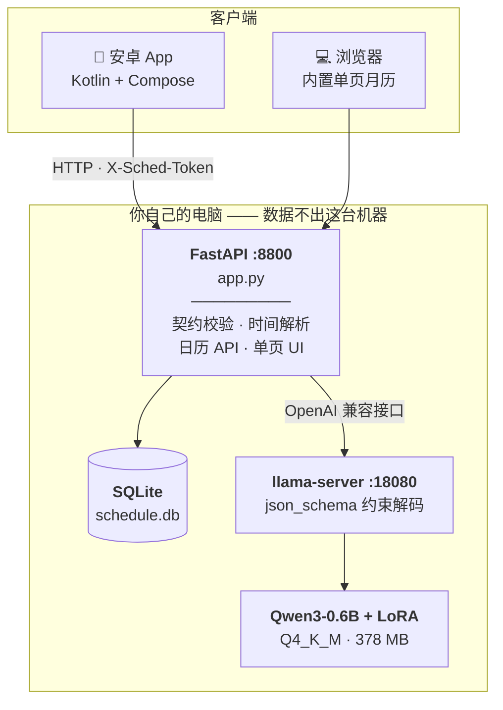
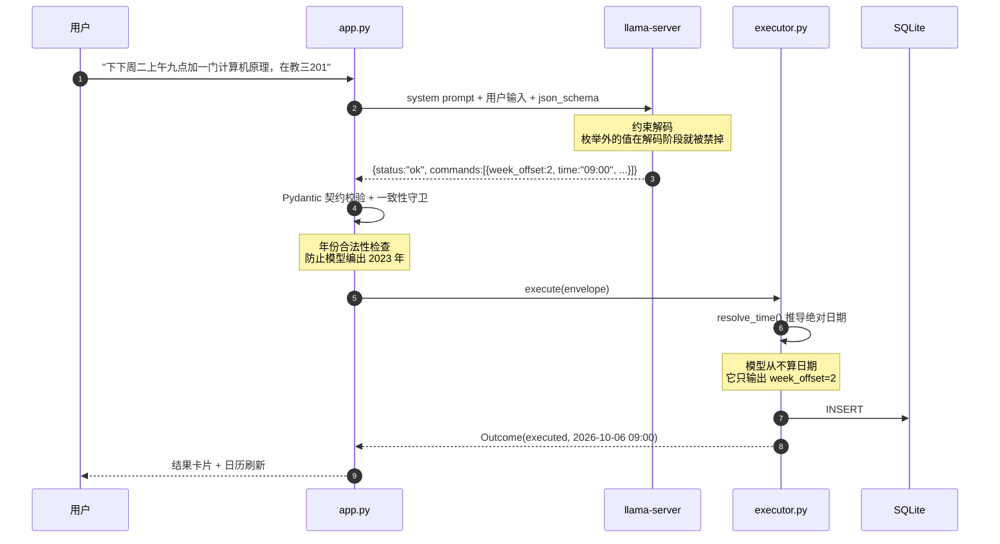
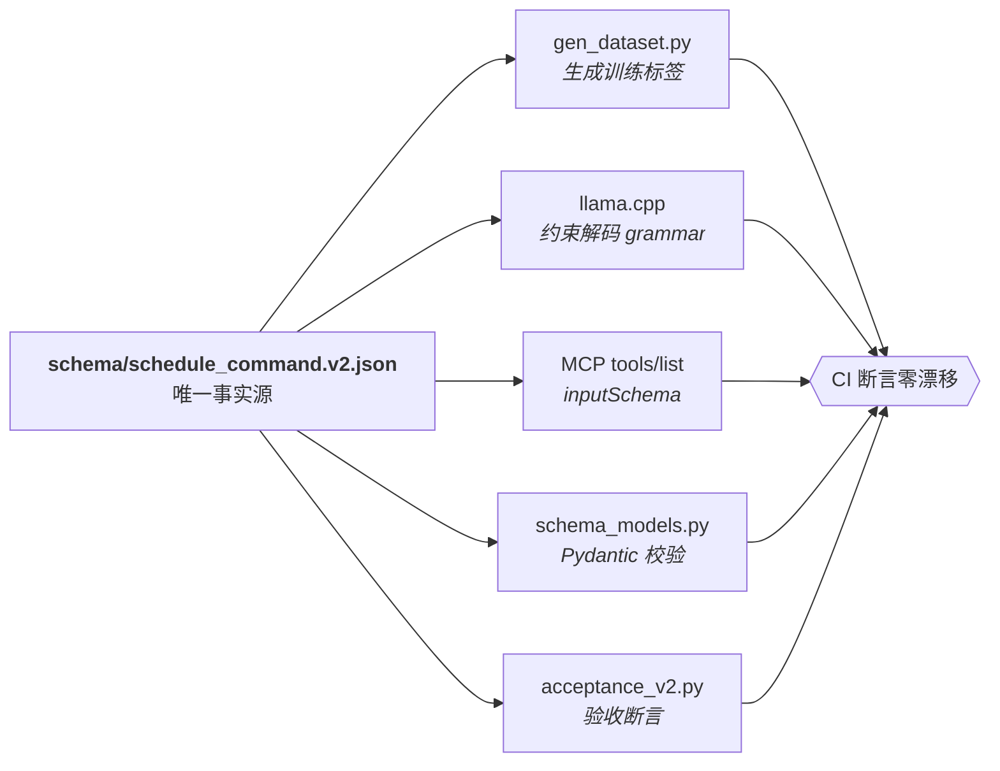
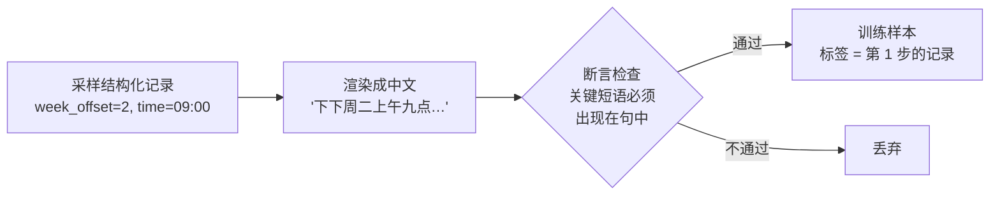

# 本地日程助手

**中文一句话 → 结构化工具调用 → 可视化日历。全部在你自己的机器上跑完。**

[English](README.en.md) · [架构](#架构) · [快速开始](#快速开始) · [设计取舍](#几个关键设计取舍都是踩坑换来的)

```text
"下下周二上午九点加一门计算机原理，在教三201"
        │
        │  Qwen3-0.6B + LoRA  ── llama.cpp 约束解码
        ▼
{"module":"class","action":"add","title":"计算机原理",
 "when":{"date_kind":"weekday","date_value":"TU","week_offset":2,
         "time":"09:00","period":"am"},"location":"教三201"}
        │
        │  Pydantic 契约校验 → resolve_time() 确定性推导
        ▼
2026-10-06 09:00  计算机原理（教三201）
```

模型只有 **0.6B**（Q4 量化后 378 MB），在一台轻薄本的核显上中位延迟 **850 ms**。
没有 API 调用，没有数据出网。

---

## 目录

- [这东西解决什么问题](#这东西解决什么问题)
- [架构](#架构)
- [一份 Schema，五处使用](#一份-schema五处使用)
- [快速开始](#快速开始)
- [性能与验收](#性能与验收)
- [训练是怎么做的](#训练是怎么做的)
- [几个关键设计取舍（都是踩坑换来的）](#几个关键设计取舍都是踩坑换来的)
- [项目结构](#项目结构)
- [已知限制](#已知限制)
- [许可](#许可)

---

## 这东西解决什么问题

让小模型可靠地**驱动真实工具**，而不是"聊得像那么回事"。

大模型接工具的常见做法是：写一个函数签名，把 JSON Schema 塞进 prompt，然后祈祷模型
输出合法 JSON，出了错再用正则或重试去救。这条路在 0.6B 这种小模型上基本走不通 ——
它会编出枚举外的值、把日期算错、把时间塞进错误的字段。

这个项目换了个思路，把"可靠"做成**结构上的保证**而不是事后补救：

| | 常见做法 | 这里的做法 |
|---|---|---|
| 输出合法性 | prompt 里写"只输出 JSON"，然后校验、失败重试 | **约束解码**：越界的枚举值在解码阶段就被禁掉，结构上不可能出现 |
| 时间计算 | 让模型算"下下周二"是哪天 | 模型只说 `week_offset: 2`，**绝对日期由确定性代码推导**，可单元测试 |
| 契约一致性 | Schema 一份、训练标签一份、校验代码一份，慢慢漂移 | **一份 JSON Schema 派生全部**，CI 断言零漂移 |
| 训练数据 | 手写或从别处捞，标签对不对全凭运气 | **反向构造**：先采样结构化记录，再渲染成中文，标签由构造保证正确 |

一句话：**把不确定性挤到它该在的地方。** 模型负责"理解中文说的是什么"，
不该负责"算日期"和"保证格式"。

---

## 架构



**手机只负责输入和展示。** 所有解析、推理、存储都在电脑端。这样手机上不用跑模型，
换手机不用迁移数据，模型升级也只在一处。

### 一次请求的完整路径



---

## 一份 Schema，五处使用

这是整个项目最核心的工程选择。`schema/schedule_command.v2.json` 是**唯一事实源**：



为什么这很重要：如果训练标签和线上校验用的不是同一份契约，模型学的和你要的就会
悄悄错开 —— 而且是**静默**错开，训练 loss 照样降，上线才发现。

做成单一事实源之后，"契约变更"变成一次原子操作：改 JSON，跑生成器，跑 CI，一起变。
`python bridge/schema_models.py schema/schedule_command.v2.json` 会在 Pydantic 镜像和
JSON Schema 之间做逐字段对比，不一致直接失败。

### 契约长什么样

```jsonc
{
  "status": "ok",                    // ok | clarify | reject
  "commands": [{
    "module": "class",               // class|exam|meeting|assignment|alarm|reminder|memo
    "action": "add",
    "title": "计算机原理",
    "when": {
      "date_kind": "weekday",        // absolute|offset_day|weekday|month_day|unspecified
      "date_value": "TU",
      "week_offset": 2,              // -2..4  ← 见"契约必须能表达用户的话"
      "time": "09:00",
      "period": "am"                 // am|pm|none
    },
    "location": "教三201"
  }]
}
```

---

## 快速开始

### 前置

- Python 3.10+
- 任意能跑 [llama.cpp](https://github.com/ggml-org/llama.cpp) 的机器
  （纯 CPU 就行；有核显 / 独显会快很多，见[性能](#性能与验收)）
- 约 400 MB 磁盘

### 1. 拿推理后端

从 [llama.cpp releases](https://github.com/ggml-org/llama.cpp/releases) 下载对应平台的构建。
只需要 `llama-server` 这一个可执行文件。

```bash
llama-server --version    # 确认能跑
```

### 2. 拿模型

从本仓库的 [Releases](../../releases) 下载 `qwen3-0.6b-sched-v4-Q4_K_M.gguf`（378 MB）。

> 想要更高质量可换 `Q8_0`（610 MB），但慢约 20%。也可以自己训 ——
> 见[训练是怎么做的](#训练是怎么做的)。

### 3. 起推理服务

```bash
llama-server \
  -m qwen3-0.6b-sched-v4-Q4_K_M.gguf \
  -ngl 99 \
  -c 2048 \
  --host 127.0.0.1 --port 18080 \
  --jinja \
  -np 1
```

- `-ngl 99`：把层全丢给 GPU/核显；纯 CPU 就写 `-ngl 0`
- `--jinja`：**必须**。服务端要按 chat template 正确解析，否则输出会不对

确认 `curl http://127.0.0.1:18080/health` 返回 ok。

### 4. 起应用

```bash
pip install -r bridge/requirements.txt

export SCHED_LLAMA_URL=http://127.0.0.1:18080
uvicorn app:app --app-dir bridge --host 127.0.0.1 --port 8800
```

打开 <http://127.0.0.1:8800>。

> Windows PowerShell 里环境变量写法是 `$env:SCHED_LLAMA_URL = "..."`，
> 换行续行用反引号 `` ` ``。
>
> 仓库里另有一套 Windows 开机自启方案（计划任务 + 崩溃自愈守候进程），
> 见 `local/supervise.ps1` 与 `docs/PROJECT-STATE.md` §七。

### 5. 让它能被手机访问（可选）

**不要直接把 8800 端口暴露到公网** —— 这个应用默认没有鉴权。
用 [Tailscale](https://tailscale.com/) 这类私有网络，或者设一个访问令牌：

```bash
export SCHED_TOKEN=$(python -c "import secrets;print(secrets.token_urlsafe(24))")
uvicorn app:app --app-dir bridge --host 0.0.0.0 --port 8800
```

设了令牌之后所有 `/api/*` 都要带 `X-Sched-Token` 请求头。网页端遇到 401 会提示输入，
安卓端在设置页填。不设令牌时行为与之前完全一致（本机开发零门槛）。

安卓客户端见 **[AI-ScheduleAssistant](https://github.com/Liu-XY2003/AI-ScheduleAssistant)**。

---

## 性能与验收

### 推理速度

同一个模型、同一个问题，只换推理后端：

| 后端 | 吞吐 | 端到端中位延迟 |
|---|---|---|
| HuggingFace `generate()` | 11.5 tok/s | ~3800 ms |
| **llama.cpp（RTX 2080 Ti）** | **272 tok/s** | **262 ms** |
| **llama.cpp（Radeon 880M 核显）** | 71 tok/s | 850 ms |
| llama.cpp（同核显，Q8_0） | 49 tok/s | 1044 ms |

**24 倍差距**，应用代码几乎没改。结论很直白：小模型本地部署，
**推理后端的选择比模型调优重要得多**。`generate()` 逐 token 都有 CPU 同步，这是它慢的根因。

> 核显那两行是 AMD Ryzen AI 9 365 + Radeon 880M（Vulkan）。Q4_K_M 比 Q8_0 快约 1.5 倍。
> 也试过 DirectML 和 XDNA2 NPU，都不如 Vulkan 路径，过程记在
> `docs/training-hardware-reality.md`。

### 正确性

| 验收项 | 结果 |
|---|---|
| 端到端用例（日期 / 周偏移 / 月偏移 / 拒答） | **21/21** |
| 日期解析单元测试 | 13/13 |
| 周 / 月偏移 | 18/18 |
| 访问控制 | 12/12 |
| 两端主题一致性 | 10/10 |
| 数据集输出符合 Schema（4372 条） | **4372/4372** |
| 数据集逐条真执行，统计失败数 | **failed = 0** |
| 契约漂移 | 0 |

最后两项值得解释：数据集里每条样本的 `assistant` 输出都会被真的喂给执行器跑一遍。
**"标签符合 Schema" 是不够的** —— 如果执行器拿到它会崩，这份数据就是不可训练的，
再合规也没用。检查在 `bridge/verify_dataset_e2e.py`。

CI 里跑的就是这批命令，见 `.github/workflows/ci.yml`。

---

## 训练是怎么做的

**反向构造法（reverse construction）**：不标注真实语料，而是反过来 ——
先采样一条结构化记录，再把它渲染成中文，标签由构造过程天然保证正确。



关键在**第三步**。生成器会记住"我在这句话里到底说了什么"（说的是"下下周"还是"下周二"、
说了"9:00"还是"上午九点"），然后断言这些短语确实出现在最终文本里，不满足就丢弃。
这样标签和文本不可能对不上。

> **为什么需要这个？** 第一版就栽在这里：采样槽位和渲染文本是两条独立路径，
> 结果出现「加个七点半的闹钟」被打上 `title:"午睡"` 这种标签。样本看着没问题，
> 训练 loss 也正常降，但模型学到的是错的。
> **反向构造把这类错误变成不可能，而不是"尽量少发生"。**

### 训练配置

| 项 | 值 |
|---|---|
| 基座 | Qwen3-0.6B（Apache-2.0） |
| 方法 | LoRA，r=16，alpha=32 |
| 数据 | 4000 训练 / 371 测试（脚本生成，非人工标注） |
| 步数 | 750 |
| 耗时 | **16 分钟**（单卡） |
| 最终 loss | 0.0003（验证集 0.0023） |
| 精度 | fp16 + GradScaler |

16 分钟出一版可用 adapter —— 这是 0.6B 这个尺寸最大的好处：
**迭代快到可以把数据质量当作主要变量来调。**

复现：

```bash
pip install -r pod/requirements-train.txt
python pod/gen_dataset.py --train 4000 --test 400 --outdir ./data
python pod/train_lora.py --data ./data --out ./output
```

> 显存吃紧就用 `--batch 4 --accum 4`。batch 8 会 OOM ——
> logits 张量是 `batch × seq × vocab`，8×270×151936×4B ≈ 1.3 GB。

---

## 几个关键设计取舍（都是踩坑换来的）

### 1. 模型不算日期

绝对时间由 `resolve_time()` 推导，模型只输出"相对于什么"和"偏移多少"。

实测模型会把 **"今年12月31号" 算成 2023 年**。加了一道年份合法性闸门：
解析出的绝对年份早于 `当前年 - 1` 就直接追问，不写入。

### 2. 契约必须能表达用户的话

v1 用枚举 `week_ref: this | next` 表示周偏移。问题是**中文有"下下周"**，
枚举里没有这一档 —— 模型只能压成 `next`，于是**静默写错一周**。

`下下周二` 被写成 `下周二`，日期差 7 天，界面上完全看不出来。

修法不是加个 `next_next`（那"下下下下周"怎么办），而是换成数值 `week_offset: -2..4`。

**契约的表达能力是模型能力的天花板** —— 契约里表达不了的东西，模型只会猜。

### 3. 约束解码优于事后校验

llama.cpp 支持 `response_format: {"type":"json_schema", ...}`，解码时直接屏蔽非法 token
的 logits：

- 越界的枚举值**结构上不可能出现**（无约束时会漏出 `fuzzy:"before"` 这类值）
- 速度几乎无损（272 vs 281 tok/s）

### 4. system prompt 是模型契约的一部分

必须与训练时**逐字节一致**。

实测把 system prompt 换掉之后，真实用例通过率从 **85% 掉到 0%**。因为模型学到的是
"在这个 prompt 下输出这个格式"，换 prompt 等于换了任务。

所以 `pod/gen_dataset.py` 的 `SYS` 和 `bridge/app.py` 的 `SYS` 必须同步修改。

### 5. 口语缩略形态必须进训练数据

「明早 / 今早 / 明晚 / 今晚」这四种缩略，如果训练数据里没有，模型会把日期整个丢掉 ——
「加个明早八点的闹钟」直接落到**今天**。

补进生成器后重训 v4，8/8 通过。**合成数据的覆盖度就是模型的能力边界。**

### 6. 结构校验放宽，语义策略收紧

模型给出 `week_offset=5` 时，正确的反应不是"Schema 校验失败"，而是让它通过结构校验，
由执行层给出可读追问。

所以 Pydantic 镜像里 `week_offset` 的边界是 `-99..99`（宽松），策略限制 `-2..4` 只在
执行层施加。**校验器管"是不是合法 JSON"，执行器管"这句人话合不合理"。**

---

## 项目结构

```
├─ schema/
│  ├─ schedule_command.v2.json      ★ 唯一事实源
│  └─ schedule_command.v1.json        历史版本（week_ref 枚举，表达力有缺陷）
│
├─ bridge/                            应用层
│  ├─ app.py                          FastAPI + 单页月历 + 可选令牌鉴权
│  ├─ executor.py                     时间解析 · 执行 · SQLite
│  ├─ schema_models.py                Pydantic 契约镜像 + 漂移检查
│  ├─ static/theme.css                ★ 由 theme/ 生成，勿手改
│  └─ test_*.py / acceptance_v2.py    回归测试与验收
│
├─ theme/
│  ├─ tokens.json                     ★ 配色唯一事实源（纸感 / 夜航）
│  └─ gen_theme.py                    生成网页 CSS + 安卓 Kotlin
│
├─ pod/                               数据生成与训练
│  ├─ gen_dataset.py                  反向构造法生成器
│  ├─ train_lora.py                   LoRA 训练
│  └─ systemd/                        服务器常驻服务
│
├─ local/                             Windows 本机部署
│  ├─ supervise.ps1                   守候进程（崩溃自愈）
│  └─ install_autostart.ps1           开机自启（计划任务）
│
├─ docs/                              设计文档与实测记录
├─ scripts/audit_secrets.ps1          开源前敏感信息审计
└─ .github/workflows/ci.yml           BOM / 脱敏 / 主题漂移 / 测试 / 数据集
```

文档里几篇比较有内容的：

| 文档 | 内容 |
|---|---|
| `docs/mcp-how-it-actually-works.md` | 现代 MCP 工具调用的五层机制，以及它和"正则解析 JSON"的本质差别 |
| `docs/training-hardware-reality.md` | GPU / NPU / 核显训练实测，包括哪些路走不通 |
| `docs/theming.md` | 两套主题的 token 流水线 |
| `docs/PROJECT-STATE.md` | 项目状态快照与设计决策全集 |

---

## 已知限制

- **`action` 目前只有 `add`。** 改和删只能在界面上手点，还没有自然语言的 update / delete。
- **没有提醒推送。** 日程存在电脑端，手机不会主动弹通知。
- **负样本偏少。** reject / clarify 各只有 14 / 10 条，拒答能力是弱项。
- **网页版用了 `color-mix()`**，需要 Chrome/Edge 111+（2023-03）。更老的浏览器上
  部分配色会退化成透明，但不会崩。
- **安卓端纸感主题的衬线标题**依赖系统字体，不同厂商 ROM 的宋体实现差异较大。
- **单人应用。** 一个后端服务一个人。多人共用需要自己加数据隔离 ——
  `Store` 是独立类，加一列作用域即可，见 `docs/PROJECT-STATE.md` §九。

---

## 许可

[MIT](LICENSE)

依赖与致谢：

| 组件 | 许可 |
|---|---|
| [Qwen3-0.6B](https://huggingface.co/Qwen/Qwen3-0.6B) | Apache-2.0 |
| [llama.cpp](https://github.com/ggml-org/llama.cpp) | MIT |
| 训练数据 | **由本项目脚本自行合成**，不含第三方数据集 |
| 安卓端 OkHttp / Jetpack Compose | Apache-2.0 |

微调后的 LoRA 权重沿用基座许可（Apache-2.0）。
