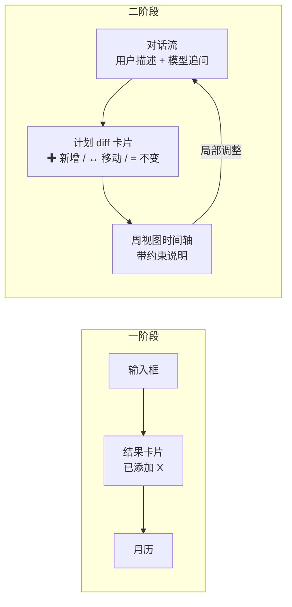

# 二阶段：客户端改造与推广路径

> 配套文档：`docs/phase2-feasibility.md`（技术可行性）
> 调研时间：2026-11。平台政策变动快，动手前请按文末清单二次核实。

---

## 一、先说结论：推广的瓶颈不是技术

三条判断，都很关键：

1. **这个产品短期内不应该上应用商店。** 不是门槛问题（虽然门槛确实高），而是
   **产品形态和应用商店的审核逻辑天然冲突** —— 详见 §三。
2. **微信小程序是个陷阱。** 看起来最容易，实际上有一道个人办不下来的死结。
3. **真正该抓住的窗口是赛事，而且只剩 6 周。** 详见 §五。

⚠️ **最紧急的一件事：第二十届全国大学生软件创新大赛预计 2026 年 12 月初报名**
（第十九届是 12-02 开始），赛题原文就是"端侧 AI / 端侧大模型 / 智能体"。
这是与你项目匹配度最高、且时间窗恰好落在毕业前的赛事。**本周就该去查本校校赛通知。**

---

## 二、客户端改造：从"输入框 + 日历"到"对话 + 计划"

### 一阶段客户端是什么

三个 Tab：添加 / 日历 / 设置。核心交互是"填一句话 → 看到一条日程被加进去"。
这是**录入工具**的形态。

### 二阶段需要变成什么

核心交互变成"**说一件复杂的事 → 得到一个方案 → 商量着改**"。这是**决策工具**的形态。



### 关键 UI 概念：「计划 diff 卡片」

这是整个二阶段最重要的界面元素。一阶段的"已添加 X"不够用了 —— 用户需要看到
**改了什么、为什么改、还有哪些风险**。

```
本周计划                                 3 处变动

  ✚ 周二 14:00–16:00   实验报告（拆成 2 块）
  ↔ 周四 组会  15:00 → 16:00   （避开高数，且满足你"两节课间留 30 分钟"）
  = 其余 5 项保持不变

  ⚠ 周五 23:59 截止前只剩 2 小时余量
    建议今晚先写初稿，[排进去]

  [ 接受 ]   [ 只接受前半周 ]   [ 告诉我怎么改 ]
```

三个设计要点：

1. **三类符号**（✚ ↔ =）让"变了什么"一眼可见，不用逐条比对。
2. **每个变动都附理由**。这是"求解器驱动"架构带来的天然优势 —— 原因是从约束里
   直接生成的，不是编的。
3. **风险单独提示，且可一键操作**。这是"秘书"感的来源。

### 技术选型

| 项 | 建议 | 理由 |
|---|---|---|
| 对话流 | Compose `LazyColumn` + 流式追加 | 复用现有 ViewModel 结构 |
| 周视图 | 自绘 Canvas 时间轴 | 月历不适合表现"时长"和"冲突" |
| 状态管理 | 现有 `ScheduleViewModel` 扩展 | 不引入新框架 |
| 提醒展示 | 先只做应用内 | 推送涉及的合规问题见 §三 |

> **建议先做 Web 端，安卓跟进。** Web 迭代快、截图方便、赛事演示也通用；
> 安卓端在交互定型后再跟，避免返工。

---

## 三、推广路径：为什么"上应用商店"是错的第一步

### 先说一个结构性矛盾

这个产品有个特性：**服务端跑在用户自己的电脑上**。

而国内的应用 / 小程序上架，都要求备案时申报**你的服务器和域名**。
"服务器是用户自己的电脑"这件事，在备案体系里没有位置 —— 你要么自己架一台服务器
（那就变成云端产品，丢了本地优先的卖点），要么填一个和实际不符的信息（不合规）。

> 这不是能不能绕过的问题，是**产品定位和监管框架不匹配**。
> 认清这一点能省掉几个月弯路。

### 四条路的真实门槛（调研结论）

| 路径 | 个人能不能做 | 真实门槛 | 结论 |
|---|---|---|---|
| **GitHub Release 直发 APK** | ✅ 能 | 无 | **一阶段就该走这条，已走通** |
| **飞书自建应用** | ✅ **能，官方鼓励** | 0 元、无备案 | **二阶段最佳通道** |
| 微信小程序 | ⚠️ 注册能，发布难 | 见下 | **不建议做主战场** |
| 国内应用商店 | ⚠️ 能，但重 | 软著 + App 备案 + 隐私合规 | **暂缓** |
| 企业微信 | ❌ 不能 | 个人注册无管理后台 | **放弃** |

### ✅ 飞书：唯一零门槛的合规通道

飞书官方文档明确写着，开发者可以**自行创建一个新企业**，在里面建自建应用、
添加权限，**实现权限免审**。管理员就是你自己，不需要企业认证，不需要备案，0 元。

- 日历 API：`calendar:calendar` 可创建/查询日程，支持 `reminders` 与 `recurrence`
- 消息推送：自建应用机器人，或更省事的自定义机器人 webhook（100 次/分钟）
- **只需要出站 HTTPS** → 本地后端能主动推，不需要公网 IP、不需要域名

**产品形态建议**：本地 LLM + 本地存储是本体，飞书只做「提醒 + 跨设备查看」的瘦通道。
数据不出本地，但你能在手机上看到今天的安排。

> 局限要说清楚：自建应用只能在本企业内用，**做不成 SaaS 分发**。
> 对"个人日程助手"其实刚好，但要服务别人，每人得自己建企业装自己的应用。

### ⚠️ 微信小程序：看起来最容易，其实坑最深

坑是层层递进的，每层都几乎不可绕过：

1. **第一层（看似赢了）** —— 个人主体能注册，「工具-日历」「办公」「备忘录」类目对个人开放，
   备案指引里"日历"也标注为"符合个人性质"。这一层确实通。
2. **第二层** —— 但要**发布**就得完成小程序备案：1–20 个工作日、本人人脸核身、名称关键词审查，
   个人主体上限 5 个。
3. **第三层** —— 后端要连自己服务器，就要求**域名已 ICP 备案 + https + 白名单**，
   等于再走一遍网站备案 + 买国内服务器。**内网穿透的免费域名一律不行**。
4. **第四层（唯一的救命通道，但是半残）** —— 官方允许局域网直连 IP + http
   （同一 WiFi、非本机 IP）。确实能用，但用户一出门用 4G 就废，
   而日程助手最需要的就是移动场景。
5. **第五层（真死结）** —— 只要 AI 生成能力在小程序里，就走「深度合成-AI 问答」类目，
   需要《互联网信息服务算法备案》。**这个备案需要市场主体（个体工商户/企业），
   个人主体办不下来。**

另外个人主体**无法微信认证**（认证支持主体列表里没有"个人"）、**无法接微信支付**。

**结论**：小程序最多做个"展示壳"，不能作为主战场。

### ❌ 企业微信：直接放弃

官方 FAQ 一句话封路：个人注册只会得到"个人账号"，**没有 Web 管理后台**，
建不了自建应用。绕道"填个企业名注册未认证企业"属于主体信息不实。

> 但**企业微信群机器人 webhook 值得顺手加**：只需出站 POST，
> 本地后端 10 行代码就能多一个推送渠道（20 条/分钟）。

### 应用商店：暂缓，但不是永远不做

个人上架国内安卓商店大致需要：**软著 + App 备案 + 隐私政策 + 各商店审核**。
软著个人可申请（官方登记免费，周期约 30–60 工作日，加急需付费），
App 备案需填服务器信息 —— 又撞回上面那个结构性矛盾。

**建议顺序**：
1. **现在**：GitHub Release 分发（已有）+ 飞书做提醒通道
2. **有稳定用户后**：再考虑商店，届时可能已有主体
3. 如果真要做商店，考虑把服务端做成"可选的云端模式"，让备案有东西可填

---

## 四、目标用户：认清谁才会用

这一点决定了所有推广动作。

| 用户群 | 规模 | 愿不愿意"在自己电脑上跑模型" | 优先级 |
|---|---|---|---|
| 极客 / AI 爱好者 | 小 | 愿意，甚至觉得酷 | **★ 首发** |
| 大学生（尤其理工科） | 中 | 部分愿意，需要保姆级教程 | ★★ 主力 |
| 普通白领 | 大 | 不愿意 | 暂不考虑 |
| 企业 | 中 | 要私有化部署，需求真实但决策慢 | 以后 |

**一句话定位**（比"AI 日程助手"精准得多）：

> **一个跑在你自己电脑上的日程规划器 —— 数据不出门，排期可解释。**

"可解释"是被严重低估的卖点：市面上的 AI 日程工具（Motion、Reclaim、Clockwise）
都是云端黑盒，用户不知道为什么被排在某个时间。你的架构天然能回答"为什么"。

---

## 五、赛事：最紧急的机会，只剩 6 周

> 以下基于 2026-11 的调研，具体日期请以官方通知为准。

### 🥇 第一优先：第二十届全国大学生软件创新大赛

**为什么是它：**

- **赛题就是你在做的事**。第二十届主题"AI赋能真实生活场景"，四大赛题含"AI融入日常"，
  原文点名"端侧AI、端侧大模型、智能体"，且明确"手机端展示须基于 Android 开发"。
  **你不需要为比赛改技术路线。**
- **时间窗完美**：预计 2026 年 12 月初报名 → 2027 年 2–4 月区域赛 → **2027 年 5 月底全国决赛**，
  全程在毕业前结束，不因毕业掉资格。
- **奖项实在**：全国一等奖 15 项 ×1.5 万元、二等奖 30 项 ×7000 元 + 企业曝光。
- **支持跨校组队**：正好补齐"商业计划书 + 演示"这类个人项目的短板。

**风险与注意：**

- **匿名评审**：材料不得出现校名、姓名、指导老师、学院、专业、班级。
  → 现有 GitHub 仓库和 App 截图里的个人信息要清理
- 校赛通常要求"原创且未参加过其他公开比赛" → 与挑战杯**存在一稿多投冲突**
- 用开源模型需**明确标注开源/非开源比例**，评委会扫描

**本周动作**：查本校教务处 / 软件学院 / 校团委的校赛通知（截止多在 12 月上中旬）。

### 🥈 第二优先：Google Summer of Code 2027

- **唯一不受毕业影响的通道**（2022 年起不再限定学生身份 —— 但这条需自行到官网 FAQ 核实，
  调研时官网抓取失败）
- 你的 llama.cpp 约束解码 / 端侧推理经验，可直接投 llama.cpp / ggml / Ollama 生态
- 作品是"上游 PR"，**与国内赛事不构成一稿多投**，可以并行
- 时间：2027 年 1–2 月组织申请、3–4 月学生申请。**11–12 月盯官网时间线发布**

### 🥉 条件触发：挑战杯（第二十届）

- **资格对你有利**：章程卡"2027 年 6 月 1 日前注册"，你 6 月毕业但 6 月 1 日仍注册 → 满足
- 选**科技发明制作 B 类**，可申报**个人作品**（承担 60% 以上工作，合作者 ≤2 人）——
  特别适合单人项目
- 北京高校校赛报名多在 **2026-10-23 至 12-10**，比软件赛更早截止

**但有个顺序冲突**：挑战杯规定"已获国家级奖励成果不得申报"。
若软件赛先在 5 月底拿了全国奖，10 月的挑战杯国赛可能被判定违规。
→ **必须向校团委书面确认，并留邮件证据。**

### ⛔ 明确不建议投入

| 赛事 | 原因 |
|---|---|
| 中国国际大学生创新大赛（原"互联网+"）2027 | 本科创意组要求"成员均为在校本科生"，2027 年 7–9 月报名时你已毕业 |
| 中国大学生计算机设计大赛（4C）第 20 届 | 须同校 2–9 人、不接受个人；且"前期作品雷同不得参赛"，你的项目已开源展示 |
| 科大讯飞星火杯 | 作品必须建在讯飞云端 Agent 平台上，与"本地推理"卖点直接冲突 |
| 华为 ICT 大赛创新赛 | 要求用昇腾/ModelArts，与本地 llama.cpp 路线相反；不建议为它改项目主线 |
| 开源之夏 OSPP 2027 | 要求"项目开发期内保持在校学生状态" —— **只有 2027 年 9 月读研才可行** |

---

## 六、三阶段展望

### 语音：先想清楚它解决什么问题

| 环节 | 候选 | 说明 |
|---|---|---|
| ASR | **FunASR / Paraformer / SenseVoice** | 中文明显优于 Whisper |
| TTS | CosyVoice2 / GPT-SoVITS | edge-tts 免费但走云端，与本地优先冲突 |
| 唤醒词 | openWakeWord / Porcupine | **建议先不做** |

**我的建议：三阶段先做「按住说话」，不做唤醒词。**
唤醒词涉及常驻监听、误唤醒、功耗和隐私敏感度，投入产出比低。

### 语音的真正难点不是技术，是口语形态

- 自我修正（"周三…不对，周四"）
- 指代省略（"那件事挪到下午" —— 哪件？）
- 长停顿、语气词、多人打断

这些会让一阶段"短句 + 固定槽位"的假设彻底失效。
**建议三阶段前先做一轮口语语料测试，再决定是否投入。**

### 比语音更该优先的：日历同步

| 方向 | 价值 | 成本 |
|---|---|---|
| **日历双向同步**（CalDAV / 飞书 / Google） | **极高** | 中 |
| 邮件 / 聊天记录导入 | 高 | 中 |
| 主动提醒与复盘（"这周你 3 次推迟实验报告"） | 高 | 中 |
| 语音 | 中 | 高 |
| 多人协商（找共同空闲） | 中 | 高（隐私） |

> **判断：三阶段真正的第一优先级应该是"日历同步"，不是语音。**
> 语音是交互形态的升级；而**不接现有日历，用户根本不会迁移过来** —— 这是留存问题，
> 语音只是锦上添花。

---

## 七、行动清单

### 本周（11 月第 1 周）

1. **查本校"软件创新大赛"校赛通知** —— 最高优先级，错过要等一年
2. 查本校挑战杯校赛通知（可能已在进行中）
3. 给软件赛组委会发邮件，书面确认"同期参加挑战杯校赛是否违规"，留证据

### 11 月内

4. 给现有 llama-server 加 `--reasoning off`，验证一阶段是否变快（**零成本优化**）
5. 跑一遍 1.7B / 4B 的抽取质量对比，定二阶段的默认模型
6. 搭 CP-SAT 求解器最小原型（不接 LLM，先手写约束输入）

### 12 月

7. 提交软件赛校赛作品（需清理仓库与截图中的个人信息）
8. 搭"杂文 → 约束"的抽取评估集

### 2027 年

9. 1–2 月：盯 GSoC 时间线
10. 3–4 月：申请 GSoC
11. 5 月底：软件赛全国决赛
12. 毕业后按精力推进 M2.2

---

## 八、需要自行二次核实的事

政策与赛程变动快，以下务必自己确认：

1. **本校校赛通知**（最关键）—— 各校时间差异大
2. 软件创新大赛第二十届的**确切报名日期**（本文按第十九届节奏推断为 12 月初）
3. 挑战杯国赛资格口径 —— 向校团委确认"2027-06-01 前注册"是否足以覆盖 10 月国赛
4. GSoC 2027 是否仍不限学生身份（官网 FAQ）
5. 一稿多投规则（留邮件证据）
6. 个人能否作为**算法备案**主体（问属地网信办，别信服务商）
7. 飞书免费版人数上限与多维表格额度
