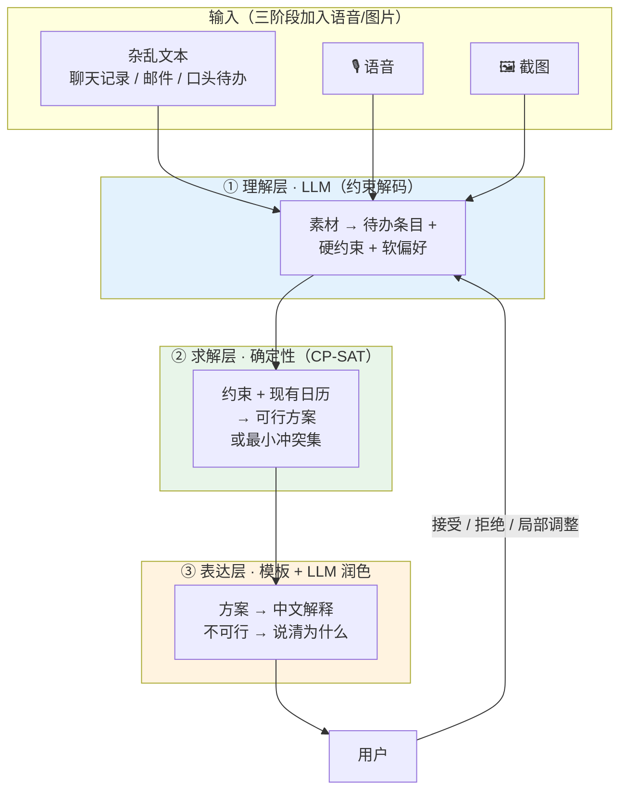

# 二阶段可行性分析与技术方案

> 状态：设计阶段（2026-11）
> 前提：一阶段已完成并开源（本地 Qwen3-0.6B + LoRA + 约束解码，21/21 验收）

---

## 一、先把"秘书/助手"拆成可判断的技术问题

一阶段做的是**单轮语义归一化**：

```
一句话  ──LLM(约束解码)──▶  结构化命令  ──确定性代码──▶  写库
```

二阶段要做三件质变的事，它们的难度完全不同，不能混在一起谈：

| # | 能力 | 技术本质 | 难度 |
|---|---|---|---|
| ① | 从**杂乱非结构化文本**里提取待办与约束 | 语义抽取（信息抽取） | 中 |
| ② | 在**约束下**排出可行且合理的计划 | **组合优化 / 约束求解** | 高，但**有确定性解法** |
| ③ | 多轮协商、接受反馈、局部调整 | 对话状态机 + 偏好学习 | 中高 |

**关键判断：② 不是语言问题。**

这决定整个架构。下面这组数据是最有力的论据 ——

> Google 的 [NATURAL PLAN](https://arxiv.org/abs/2406.04520) 专门构造了三个自然语言规划任务，
> 其中之一就是 **Calendar Scheduling**（正是本项目要做的事）。
> 结果：即使给了模型完整的日历上下文，**GPT-4 和 Gemini 1.5 Pro 在 Trip Planning 上
> 只有 31.1% / 34.8% 的求解率**，复杂度上去后（10 个城市）**所有模型都低于 5%**。

这说明两件事：

1. **靠"让 LLM 直接排出计划"这条路走不通** —— 不是模型不够大，是范式不对。
2. **换更大的模型也解决不了** —— GPT-4 都只有三成。

所以正确做法是学术界已经验证过的那条路：

> [LLM+P](https://arxiv.org/abs/2304.11477)：**LLM 只负责把自然语言翻译成形式化描述，
> 求解交给专业的规划器。**

这恰好是本项目一阶段已经确立的方法论的自然延伸：

> 一阶段的信条是「**模型不算日期，绝对日期由确定性代码推导**」。
> 二阶段把它推广成「**模型不做规划，计划由确定性求解器得出**」。

**同一个原则，更大的作用域。** 这是本项目二阶段最重要的一句话。

---

## 二、目标架构：三层 + 修订回路



### 三条不可让步的设计约束

**1. 求解层不走 LLM。**
LLM 的输出是"约束"，不是"排好的时间"。前者可以被验证，后者只能被信任。

**2. 不可行时必须给出"为什么"。**
CP-SAT 能做**最小冲突集**（minimal unsatisfiable subset）：告诉用户
"你想把这门课放在周二下午，但周二下午已有高数，且你要求两节课之间留 30 分钟 ——
冲突的是这两条"。这比"排不出来"有用一百倍，也是纯 LLM 方案永远做不到的。

**3. 每轮只产出 diff，不重排全局。**
用户确认过的东西被莫名其妙挪走，是这类产品最劝退的体验。要把"稳定性"当成一条
**带权重的软约束**来优化，而不是事后修补。

---

## 三、可行性逐项评估

| 能力 | 结论 | 依据 / 做法 |
|---|---|---|
| 杂乱文本 → 待办 + 约束 | ⚠️ **有条件可行** | 需要升级模型 + 专门的抽取训练集；见 §四 |
| 约束建模 | ✅ 可行 | 硬/软约束分层，见 §五 |
| 求解 | ✅ **高度可行，且是差异化优势** | OR-Tools CP-SAT，成熟工业级 |
| 多轮协商 | ⚠️ 有条件可行 | 需要会话状态与"只解析差异"的设计；见 §六 |
| 局部调整 | ✅ 可行 | 增量求解（固定已确认项，只解剩余） |
| 解释生成 | ✅ 可行 | 模板为主 + LLM 润色，不必让 LLM 自由发挥 |
| 规划质量评估 | ⚠️ **最容易被忽略、也最容易翻车** | 见 §七 |
| 多模态（三阶段） | ✅ 可行，有成本 | 见 §八 |

**整体结论：技术路径清晰，主要风险不在算法，而在"抽取质量"和"评估体系"。**

---

## 四、模型选型：0.6B 必须换

### 为什么 0.6B 撑不住

一阶段的 0.6B 能工作，是因为任务被压得极窄：短句、固定槽位、约束解码兜底。
二阶段的抽取任务要处理：

- 长得多、乱得多的输入（一段聊天记录里混着三件待办、两个时间、一句抱怨）
- **隐含约束**（"周三上午别给我排东西" 隐含一条软约束）
- **歧义与冲突**（"下午三点"和"15:00 有个会"是不是同一件事）

这类任务对模型的世界知识和指令跟随能力要求高一个量级。

### 候选与实测

> 以下全部是**本机实测**，不是估算。环境：AMD Ryzen AI 9 365 + Radeon 880M 核显（Vulkan），
> Q4_K_M，`-ngl 99`，`n_ctx=8192`，llama.cpp build 11053。
> 复现脚本：`local/bench_models.ps1`、`local/bench_reasoning.ps1`、`scripts/bench_ttft.py`。

| 模型 | Q4 大小 | 实测吞吐 | 128 token 耗时 | 进程内存 | 定位 |
|---|---|---|---|---|---|
| Qwen3-0.6B | 0.38 GB | **111.5 tok/s** | 1.2 s | 1.6 GB | 一阶段够用，二阶段抽取能力不足 |
| Qwen3-1.7B | 1.0 GB | **51.5 tok/s** | 2.7 s | 2.4 GB | **交互档**（快，质量居中） |
| **Qwen3-4B** | 2.4 GB | **22 tok/s** | 5.9 s | 4.1 GB | **质量档**（慢，抽取更准） |
| Qwen3-8B | 5.0 GB | 未实测（按带宽推算 ~10 tok/s） | ~13 s | ~7 GB | 核显上不现实 |
| Qwen3-14B | 9.0 GB | 未实测 | ~26 s | ~12 GB | 不推荐 |

### ⚠️ 实测发现的三个坑（原方案没预料到）

#### 坑 1：Qwen3 默认开启思考模式，4B 会**一个正文字都不输出**

实测（`local/bench_reasoning.ps1`）：

| 配置 | 思考 chunk | 正文 chunk | 总时长 | 结果 |
|---|---|---|---|---|
| 4B 默认（auto） | **298** | **0** | 13.4 s | **完全不可用** |
| 4B `--reasoning off` | 0 | 104 | 4.8 s | 正常 |
| 4B `--reasoning-budget 0` | 0 | 297 | 13.9 s | **仍在"思考"，只是被塞进 content** |

裸 4B 在 300 token 预算内把所有 token 都花在思考上，正文一个没吐。
**这不是慢的问题，是根本出不来结果。**

而且我一开始的假设 —— "约束解码强制输出以 `{` 开头，会天然压制思考" —— 实测是**错的**：
加不加 `json_schema`，思考 chunk 都是 298，一模一样。

**正确的开关是 `--reasoning off`**（llama.cpp 为 `-rea on|off|auto`）。
`--reasoning-budget 0` 不解决问题 —— 它只改文本塞到哪个字段，模型照旧"想"。

而且生产用的 LoRA 微调 0.6B **同样在思考**（实测 237 个思考 chunk，约 2 秒开销）。
→ **这同时是二阶段的前提、也是可以立刻优化一阶段的机会**：给现有服务加 `--reasoning off`。

#### 坑 1b：关掉思考对一阶段是纯赚

在生产模型（0.6B LoRA）上做对照实验，同样的 system prompt + `json_schema`，5 个代表性用例
（`scripts/probe_reasoning_off_quality.py`）：

| 配置 | 平均延迟 | 平均输出 token | 输出结果 |
|---|---|---|---|
| 思考开启（现状） | **1900 ms** | ~166 | 完全相同 |
| `--reasoning off` | **526 ms** | ~51 | 完全相同 |

**输出逐字一致，快 3.6 倍，token 少 3.2 倍。**

原因很清楚：思考内容在结构化抽取任务上是纯浪费 —— 模型已经会用约束解码保证格式，
不需要"想清楚要输出什么格式"。**这是一阶段可以立刻落地、零风险的优化。**

#### 坑 2：约束解码在 4B 上把输出长度砍到 1/3

同样的 4B、同样关掉思考，只差 `json_schema`：

| 配置 | 正文 chunk | 总时长 | 输出 |
|---|---|---|---|
| 不加约束 | 104 | 4.8 s | `好的，以下是将这句话转换成日程指令的示例：\n\n**日程指令：**  \n- 日期：下周二…` |
| 加 json_schema | **37** | **2.3 s** | `{"module":"meeting","title":"会议","time":"下周二上午九点","duration_min":60}` |

**2.8 倍的 token 削减 + 格式立刻正确。** 这是对一阶段"约束解码"决策在更大模型上的再次验证：
它不只是保证格式，还直接省时间。二阶段必须继续用。

#### 坑 3：`--reasoning-budget 0` 还带出了旧 bug

上面第三组配置里，模型把 `time` 写成了 `"2023-11-07T09:00:00"` —— **又编出了 2023 年和
一个绝对日期**。正是一阶段已经踩过的那个坑。

这说明：**"模型不算日期"这条铁律在二阶段同样适用，而且更大模型并不会自动变好。**
`resolve_time()` 那套确定性推导要原样保留。

### 推论：按延迟预算分两档用不同模型

这是实测之后才清楚的结论 —— 二阶段有两种完全不同的延迟场景：

| 场景 | 可接受延迟 | 该用哪个 |
|---|---|---|
| **交互式抽取**（用户说了句什么，等回复） | < 2 s | **1.7B + `--reasoning off` + 约束解码** |
| **批处理规划**（"帮我排这周"，可以转圈） | 10–20 s | **4B**，配进度提示 |

不要指望一个模型通吃。界面上可以做成"快速模式 / 深度模式"，底层就是换模型 + 换超时。

### 一个反直觉但重要的推论

**架构上让 LLM 少干活，正好也让小模型够用。**

因为 LLM 只需要输出"约束清单"（几十到几百 token），而不是"完整计划"（几千 token），
所以 1.7B 在 51 tok/s 下能做出 1–2 秒的响应。如果让模型直接吐一周排期，
同样的模型会慢到不可用 —— **这两件事是同一个决策的两面。**

### 上下文必须扩容

当前 `llama-server -c 2048`，这是二阶段的**硬阻塞**：

| 组成 | 当前 | 二阶段需要 |
|---|---|---|
| system prompt | 0.6 KB | 3–5 KB（约束词汇表长得多） |
| JSON Schema | 4.4 KB | 10–15 KB |
| 现有日历摘要（一周 ~20 条） | — | ~2 KB |
| 对话历史（3–5 轮） | — | 2–4 KB |
| 输出 | ~200 token | 500–1500 token |

**结论：至少 8K，建议 16K。** 代价是 KV cache 变大，可用 `-ctk q8_0 -ctv q8_0`
量化 KV cache 缓解。这一项要在动手前先压测，因为它直接决定硬件门槛。

---

## 五、约束模型：把"秘书的常识"变成可求解的东西

### 分两层

**硬约束（违反即不可行）**

- 时间不重叠
- 固定事件（已确认的课/会/航班）不可移动
- 地点转移需要 buffer（教三 → 图书馆 15 分钟）
- 截止时间前必须完成
- 显式依赖（"先写完初稿再改"）

**软约束（带权重，违反扣分）**

| 软约束 | 权重建议 | 说明 |
|---|---|---|
| 偏好时段（难题放上午） | 中 | 由用户历史行为学习 |
| 同类任务合并 | 低 | 减少上下文切换 |
| 每日负荷上限 | 高 | 防止"排得满满当当但根本做不完" |
| 考试/汇报前留缓冲 | 高 | 学生的刚需 |
| **稳定性**（少改动已确认项） | **很高** | 体验关键 |
| 不要把大块任务切碎 | 中 | 深度工作需要连续时间 |

### 为什么用 CP-SAT 而不是 Z3

- **Z3** 擅长可满足性判定（有解/无解），做优化要手写循环
- **CP-SAT** 原生支持区间变量、`NoOverlap`、可选区间、优先级目标函数

日程排布几乎就是 CP-SAT 的教科书场景。参考
[OR-Tools 排班文档](https://developers.google.com/optimization/scheduling/employee_scheduling)。

### 契约：把"唯一事实源"的思路延续下去

一阶段的经验是"一份 JSON Schema 喂给五处"。二阶段应该新增两份：

- `schema/planning_request.v1.json` —— LLM 的输出（待办 + 硬/软约束 + 对话行为）
- `schema/plan_diff.v1.json` —— 求解器的输出（新增/移动/保持 + 冲突说明）

这样"LLM 输出是否合法"依然可以用约束解码保证，和一阶段完全一致的方法论。

---

## 六、多轮对话：状态机 + 只解析差异

### 最容易做错的地方

把"最近 N 轮对话原文"直接塞给模型 → 上下文膨胀、小模型迅速变笨、前后矛盾。

### 建议做法

维护一份**结构化会话状态**，每轮只把摘要喂给模型：

```jsonc
{
  "plan_id": "w47",
  "confirmed": ["周二 09:00 高数", "周四 14:00 组会"],
  "tentative": [{"task": "实验报告", "deadline": "周五 23:59"}],
  "rejected": [{"slot": "周三下午", "reason": "要打球"}],
  "open_questions": ["报告需要连续 3 小时还是一次写完？"]
}
```

每轮用户说话，模型只做一件事：**判断这是"新信息"、"修改"还是"确认"**，
产出对应的 `dialogue_act`。求解器负责把状态推进。

### 说话的原则

| 情况 | 该怎么做 |
|---|---|
| 信息缺失但**有合理默认** | 先按默认排，明确告知"我按 X 排了，不对告诉我" |
| 信息缺失且**默认风险大**（如截止时间） | 追问，且一次只问一个 |
| 约束冲突 | 给出最小冲突集 + 两个可选方案让用户选 |
| 用户说得模糊但有多种解法 | 给 2–3 个方案，说清差别 |

> 一阶段已经有 `need_clarify` 的雏形。二阶段要把它从"表达式兜底"升级成
> **一等公民的对话行为**。

---

## 七、评估：这是项目的生死线

大多数个人 AI 项目死在这里：能演示，但说不清"多好"。

### 必须建立的指标

| 指标 | 定义 | 目标 |
|---|---|---|
| **硬约束满足率** | 产出计划违反硬约束的比例 | **必须 100%**（不是"高"，是"必须"） |
| 软约束得分 | 加权得分 / 理论最优 | ≥ 85% |
| **计划稳定性** | 重排后未变动的已确认项占比 | ≥ 90% |
| 澄清准确率 | 该追问时追问、不该追问时不打扰 | ≥ 90% |
| 抽取 F1 | 从杂乱文本抽出的待办 vs 人工标注 | ≥ 0.85 |
| 端到端延迟 | 一次完整规划 | ≤ 3 s（核显 4B） |

### 可直接借用的公开基准

**NATURAL PLAN 的 Calendar Scheduling 子任务** —— 正好对应本项目二阶段，
可以直接拿来跑分，这比自己造一套评估更有说服力，也更容易写进赛事材料。

### 自建测试集的建议

沿用一阶段的"反向构造"思路：

1. 先随机生成一份日历 + 一组待办 + 一组约束
2. **用求解器解出来，确认有可行解**
3. 再把这份约束渲染成中文（多种口吻：正式 / 口头 / 夹杂聊天记录）
4. 标签由构造保证正确

这样就有了带 ground truth 的评估集，而且能测"抽取"和"求解"两段分别的错误。

---

## 八、三阶段：语音与多模态

### 语音链路

```
🎙 唤醒 → ASR → 文本 → [一阶段/二阶段主链路] → TTS → 🔊
```

| 环节 | 候选 | 说明 |
|---|---|---|
| ASR | **FunASR / Paraformer / SenseVoice** | 中文明显优于 Whisper，见 [FunASR 模型选择](https://modelscope.github.io/FunASR/model-selection.html) 与[实测对比](https://github.com/modelscope/FunASR/discussions/2947) |
| TTS | **CosyVoice2** / GPT-SoVITS / edge-tts | [横向对比](https://www.cnblogs.com/chenying99/p/20698841)；edge-tts 免费但走云端，与"本地优先"冲突 |
| 唤醒词 | openWakeWord / Porcupine | 可选，第二阶段先做"按键说话"更简单 |
| VAD | Silero VAD | 断句、判断说完了 |

**建议：三阶段先做「按住说话」而不是唤醒词。** 唤醒词涉及常驻监听、误唤醒、
功耗和隐私敏感度，投入产出比低。

### 关键技术风险

语音不是"加个 ASR 就完事"，真正的难点是**口语的形态**：

- 自我修正（"周三…不对，周四"）
- 省略（"那件事挪到下午"—— 指代哪件？）
- 长停顿、语气词、多人打断

这些会让一阶段那套"短句 + 固定槽位"的假设彻底失效。**建议三阶段前先做一轮
口语语料的抽取测试，再决定要不要投入。**

### 其他值得考虑的功能拓展

| 方向 | 价值 | 成本 |
|---|---|---|
| **日历双向同步**（CalDAV / Google Calendar / 飞书） | 极高 —— 不接现有日历，用户不会迁移 | 中 |
| **邮件/聊天记录导入** | 高 —— 这是"秘书"的真实输入源 | 中 |
| **主动提醒与复盘**（"这周你 3 次推迟实验报告"） | 高 —— 从"工具"变"顾问" | 中 |
| 多人协商（找共同空闲时间） | 中 | 高（涉及隐私） |
| 行程/出行一体化（交通时间、天气） | 中 | 中（依赖外部 API，与本地优先冲突） |
| 语音 | 中 | 高 |

> **我的判断：三阶段真正该优先级最高的不是语音，而是"日历同步"。**
> 语音是交互形态的升级，日历同步决定用户会不会真的用起来。

---

## 九、路线图建议

### 二阶段拆成两个可交付里程碑

**M2.1 —— 从"命令"到"方案"（不含多轮）**

1. 契约升级：`planning_request` + `plan_diff`
2. 求解器接入（CP-SAT）+ 可行性/最小冲突集
3. 模型换成 Qwen3-4B，n_ctx 提到 8K–16K
4. 评估框架 + 复用 NATURAL PLAN 子集
5. 客户端加"计划视图"（不再只是日历 + 输入框）

> 完成后就能演示：**贴一段乱糟糟的待办 → 生成一个可行周计划 → 说明为什么这么排。**

**M2.2 —— 从"方案"到"协商"**

6. 会话状态 + `dialogue_act`
7. 增量求解（只解差异，保证稳定性）
8. 澄清策略与追问
9. 计划 diff 的 UI（接受/拒绝/局部调整）

### 明确不做的事

- ❌ 让 LLM 直接输出排期
- ❌ 自建 ASR（用现成的）
- ❌ 一开始就做唤醒词
- ❌ 为了"看起来智能"而放弃可解释性

---

## 十、风险清单

| 风险 | 影响 | 缓解 |
|---|---|---|
| **思考模式没关掉** | **4B 一个正文字都不出**（实测） | 启动参数必须带 `--reasoning off`；写进配置模板，CI 断言 |
| **抽取质量不达标** | 全链路崩 | 先做抽取的单点评估，不达标就换模型/加数据 |
| **评估体系缺失** | 无法证明"好"，赛事/推广都吃亏 | 和功能同步建，不要事后补 |
| 上下文扩容后速度骤降 | 体验崩 | 先压测；用 `-ctk q8_0 -ctv q8_0` 量化 KV cache；分档模型 |
| 多轮让小模型"变笨" | 对话像傻子 | 只喂结构化状态摘要，不喂原文 |
| 大四精力有限 | 半途而废 | M2.1 / M2.2 严格切分，M2.1 单独可交付 |
| 客户端返工过大 | 拖慢进度 | 计划视图可以先只做 Web，安卓后跟 |

---

## 十一、一句话总结

> **二阶段的核心不是"让模型更聪明"，而是"把规划从模型手里拿走，交给求解器"。**
> 模型负责听懂，求解器负责算对，模板负责说清 —— 各司其职，
> 这既是一阶段方法论的自然延伸，也是被公开基准证明过唯一可靠的路。
